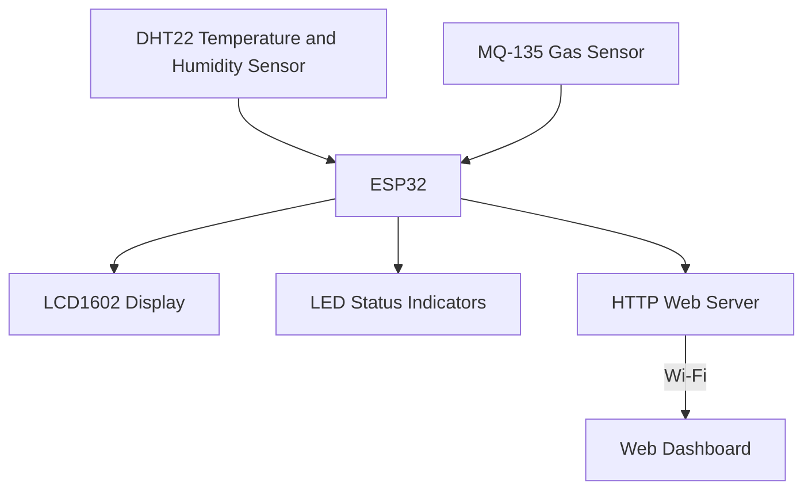

# ESP32 Air Quality Monitor


## Project Overview

An ESP32-based environmental monitoring system that measures
temperature, humidity, and relative air quality in real time.
The project was developed to provide a convenient way to
monitor environmental conditions before outdoor activities.

The system integrates a 16×2 LCD, LED status indicators, and
a Wi-Fi-enabled web dashboard. After developing a functional
breadboard prototype, a custom two-layer PCB was designed in
KiCad to integrate the hardware into a single board.

## Key Features

- Real-time temperature and humidity monitoring
- Relative air quality monitoring
- 16×2 LCD for local sensor readings
- LED-based air quality status indicators
- Wi-Fi-enabled web dashboard
- ESP32-based embedded firmware
- Custom two-layer PCB designed in KiCad
- Integrated USB-to-UART programming interface

## System Architecture

The ESP32 collects and processes environmental sensor data,
controls the LCD and LED indicators, and hosts a local web
server for wireless monitoring.



## Hardware - Prototype

A functional breadboard prototype was developed to establish
sensor functionality, microcontroller communication, and
system integration before transitioning to a custom PCB.

### Components

| Component | Purpose |
| --- | --- |
| ESP32 Development Board | Processing and wireless communication |
| DHT22 | Temperature and humidity sensing |
| MQ-135 | Gas sensing |
| LCD1602 | Local data visualization |
| Red, Yellow, and Green LEDs | Air quality status indication |
| Potentiometer | LCD contrast adjustment |
| Resistors | Current limiting and signal conditioning |


## Hardware - PCB Design

Following the development of the breadboard prototype, a
custom two-layer PCB was designed in KiCad to consolidate
the hardware into a single integrated system.

### Design Considerations

- ESP32-WROOM-32E module integration
- USB-to-UART communication using the CP2102N
- USB-C connectivity
- 5 V to 3.3 V voltage regulation
- Power supply decoupling capacitors
- Boot and reset circuitry
- Dedicated power and ground copper pours
- Sensor and display integration

### Schematic


### Front Copper Layer


### Back Copper Layer


The KiCad schematic, PCB layout, and manufacturing files
can be found in the [Hardware](Hardware/) directory.

## Firmware

The firmware was developed in C++ using the Arduino
framework for the ESP32.

### Firmware Functionality

- Acquisition of temperature, humidity, and gas sensor data
- Processing of environmental sensor readings
- Air quality classification using predefined thresholds
- Periodic LCD updates
- Control of LED status indicators
- Wi-Fi network connectivity
- HTTP web server for wireless monitoring

The firmware source code can be found in the
[Firmware](Firmware/) directory.

## Web Dashboard

The ESP32 hosts a local HTTP web server that allows users
to monitor environmental conditions through a web browser.

The dashboard was developed using HTML, CSS, and JavaScript
and displays temperature, humidity, gas sensor readings,
and air quality status.

## Testing and Validation

The breadboard prototype was developed and tested before
transitioning to the custom PCB design.

Prototype testing focused on:

- Temperature and humidity sensor readings
- Gas sensor response
- LCD functionality
- LED status indicators
- Wi-Fi connectivity
- Web dashboard functionality

The MQ-135 is used for relative air quality monitoring
rather than calibrated gas concentration or standardized
Air Quality Index (AQI) measurements.

## Firmware Setup

1. Install the Arduino IDE.
2. Install the ESP32 board package through the Boards Manager.
3. Select the appropriate ESP32 development board.
4. Install the required sensor and LCD libraries.
5. Open the firmware file from the Firmware directory.
6. Configure the Wi-Fi network credentials.
7. Compile and upload the firmware to the ESP32.
8. Open the Serial Monitor at a baud rate of 115200.
9. Locate the ESP32's assigned IP address.
10. Enter the IP address into a web browser connected to
    the same network.

## Repository Structure

```
Air-Quality-Monitor/
├── Firmware/
├── Hardware/
├── Images/
└── README.md
```

## Project Status

The breadboard prototype, embedded firmware, and web dashboard 
have been successfully developed and tested. The custom PCB 
schematic, layout, and routing have also been completed in KiCad. 
However, PCB fabrication and assembly have not yet been pursued 
due to limited access to the necessary soldering equipment and 
assembly resources. Future development will focus on manufacturing, 
assembling, and validating the custom PCB.

## Future Improvements

- Fabricate and validate the custom PCB
- Calibrate the gas sensor
- Implement historical sensor data logging
- Improve firmware modularity
- Design a protective enclosure

## Tools and Technologies

- KiCad
- Arduino IDE
- C++
- ESP32
- HTML
- CSS
- JavaScript
- Wi-Fi
- HTTP
- UART
